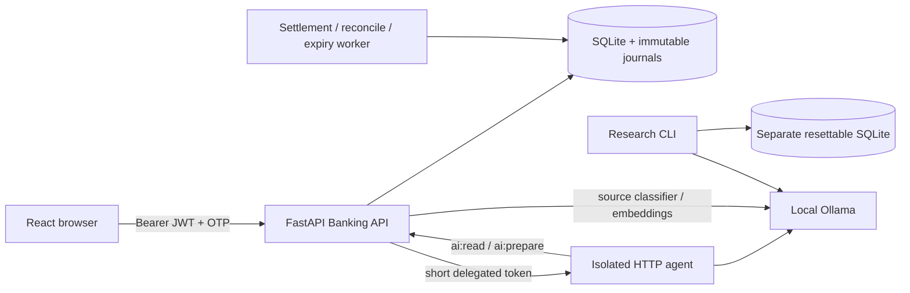

# Mô hình dữ liệu và kiến trúc

Schema tăng dần đến migration 8. Bảng cũ và history được bảo toàn. Dữ liệu tài chính và phiên nằm ở Banking API, agent không mount DB.

```mermaid
erDiagram
  users ||--o{ accounts : owns
  users ||--o{ user_sessions : authenticates
  user_sessions ||--o{ refresh_tokens : rotates
  users ||--o{ mfa_challenges : verifies
  users ||--o| mfa_settings : configures
  users ||--o| customer_profiles : identifies
  users ||--o| notification_preferences : configures
  accounts ||--|| ledger_accounts : maps
  ledger_accounts ||--o{ ledger_entries : posts
  accounts ||--o{ transactions : records
  transactions ||--o| transaction_details : snapshots_transfer
  transactions ||--o| product_transaction_details : snapshots_product
  users ||--o{ transfers : initiates
  transfers ||--|| transfer_quotes : fixes_fee
  transfers ||--o| interbank_settlements : settles
  users ||--o{ action_challenges : confirms
  users ||--o{ beneficiaries : saves
  users ||--o{ cards : holds
  cards ||--o{ card_transactions : records
  users ||--o{ bills : pays
  users ||--o{ savings : deposits
  savings ||--o{ savings_events : records
  users ||--o{ savings_goals : targets
  users ||--o{ budgets : limits
  users ||--o{ support_tickets : requests
  support_tickets ||--o{ ticket_messages : replies
  support_tickets ||--o{ ticket_attachments : attaches
  users ||--o{ conversations : chats
  conversations ||--o{ agent_runs : invokes
  agent_runs ||--o{ agent_calls : traces
  agent_runs ||--o{ tool_approvals : proposes
  knowledge_documents ||--o{ knowledge_chunks : indexes
```

Cardinality mô tả quan hệ nghiệp vụ; một số owner/journal references là khóa logic để tương thích schema cũ. Các hệ thống `SYS-*` không có customer account. Giá trị tiền là integer VND. `banking_audit`, ledger và completed history có trigger chặn UPDATE/DELETE/REPLACE theo phạm vi bảng. Notification và product snapshots cùng transaction với posting.

Research dùng JSON dataset/results và SQLite riêng thay vì đưa attack payload vào DB người dùng. Nguồn có vector, owner và trust metadata. Mỗi case reset từ template, có đối soát sau thực thi. Các bảng research không nằm trong database ngân hàng chính.
