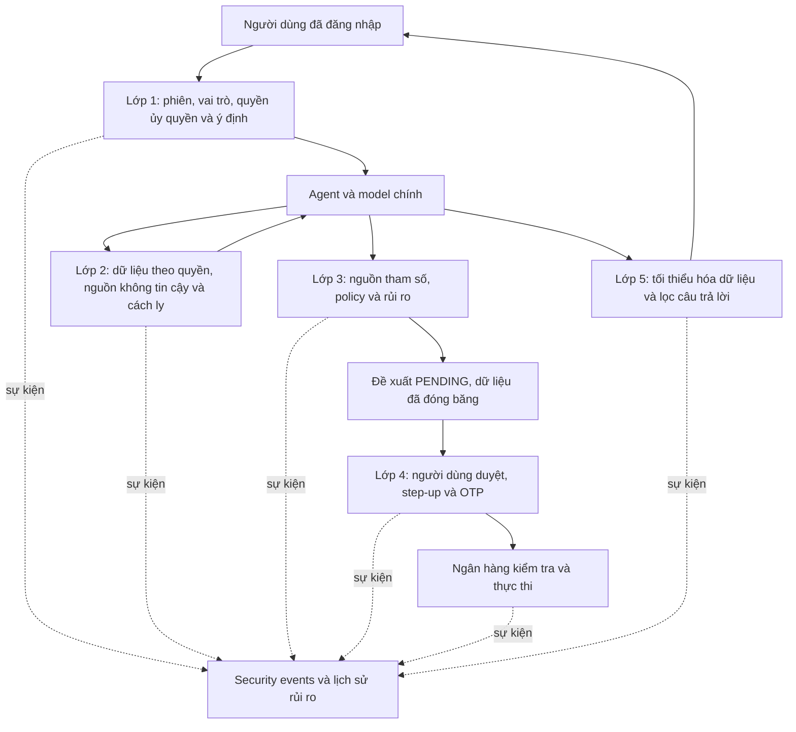

# Action Gateway — thiết kế hiện tại từ code, 15/11/2026

**Đây là tài liệu thiết kế mới**, được lập từ mã nguồn hiện tại và [kế hoạch Week8](ke-hoach-agent-build-week8.md). Người dùng đã xác nhận không có tài liệu thiết kế gốc và hội thoại gốc của các sự cố mentor. Tài liệu này không phải bản khôi phục, không tự nhận là bảng 72 bước 0.1–4.5 trước đây, và không chứng minh diễn biến của các sự cố lịch sử.

Mốc nguồn: nhánh `week8/t1-security-events`, nền `6a6617e`, có các thay đổi Week8 chưa commit. Các đường dẫn hàm/module dưới đây là nguồn đối chiếu cho thiết kế; kết quả chạy thực tế và giới hạn nằm trong [RESULTS](release/week8/RESULTS.md), [sổ tiến độ](release/week8/progress.md) và [kiểm tra nghiệm thu](release/week8/COMPLETION_AUDIT.md). Thay đổi hành vi sau mốc này phải cập nhật tài liệu cùng bằng chứng kiểm thử. Tài liệu mô tả code, không tự xác nhận mọi yêu cầu đã hoàn thành.

## Phạm vi và các quyết định hiện tại

- Mặc định chạy cấu hình D. A/B/C chỉ có trong phiên đo lab/demo được quản trị viên mở cho người dùng được chỉ định, có thời hạn; không phải công tắc tắt bảo vệ toàn hệ thống.
- Agent chỉ đọc hoặc lập đề xuất. Customer agent không có công cụ tạo user/tài khoản hoặc xác nhận chuyển tiền. Thao tác ngân hàng cuối cùng vẫn cần quyền của người dùng, dữ liệu đã đóng băng và các bước xác minh tương ứng.
- Giữ sáu công cụ `propose_*` của staff, có duyệt và kiểm quyền lại. Khi bật `dual_llm`, `read_ticket` qua model cách ly trước khi vào model chính. Đây là quyết định hiện tại thay cho mục QĐ10 không có tài liệu nguồn.
- Chỉ cho customer đọc dữ liệu tài chính của chính mình khi yêu cầu tương ứng; không gửi số tài khoản đầy đủ của người khác hoặc thông tin liên hệ không cần thiết vào model. Support không có quyền đọc số dư.
- Chức năng mới để demo là đổi hạn mức chuyển tiền cá nhân qua đề xuất, duyệt và xác minh. Dữ liệu demo Week8 là dữ liệu tổng hợp riêng, không ghi đè DB đang chạy.
- Ngưỡng rủi ro và thời gian chờ là lựa chọn kỹ thuật có thể cấu hình, chưa phải mô hình chống gian lận đã được chứng nhận hoặc chuẩn chung của ngành. [Hiệu chuẩn thực tế](release/week8/T6_BENIGN_CALIBRATION.md) đã chạy 100 yêu cầu chính và 20 yêu cầu bổ sung: 100 đề xuất có dải đúng kỳ vọng; chín lần thiếu detector và một lần sai tham số được giữ trong kết quả của snapshot cũ.
- Quyền sử dụng Prompt Guard phải do con người chấp nhận. Người dùng chưa chấp nhận giấy phép ở thời điểm lập tài liệu; cài thư viện không thay thế giấy phép hoặc trọng số hợp lệ.

## Năm lớp kiểm soát và luồng thực thi

Các lớp là cách nhóm để giải thích, không phải năm dịch vụ hoặc năm bước độc lập duy nhất. Bảo vệ quyền, bước xác minh và ghi sổ được thực hiện ở nhiều điểm trong bank backend.

| Điểm thực thi | Hành vi hiện tại và nguồn code | Kiểm thử liên quan |
|---|---|---|
| Tạo run | `agent_access.create_run` kiểm phiên, chủ hội thoại, quota, cấu hình và input guard; gắn vai trò, danh sách tool, hash ý định và run vào token ủy quyền. Nội dung yêu cầu và bảng bí danh được lưu mã hóa. | [delegation/agent tests](../backend/tests/test_AI_12.py), [gateway session](../backend/tests/test_gateway_session.py) |
| Dùng quyền ủy quyền | `authenticate` bắt buộc `tools`, `intent`, `role`, kiểm phiên/auth version/vai trò hiện tại/run còn mở. `execute_tool` kiểm công cụ và hash trước đề xuất theo lớp `intent_binding`; schema và quyền ngân hàng là lớp riêng. | [policy integration](../backend/tests/test_policy_integration.py), [policy](../backend/tests/test_policy.py) |
| Đọc dữ liệu | Truy vấn customer giới hạn theo chủ; staff theo quyền thực tế. `disclosure` hạn chế theo trường/mục đích; pseudonymizer che định danh. `get_bills` nhận tùy chọn status `UNPAID`/`PAID` không phân biệt hoa thường và lọc hóa đơn của chính chủ; từ chối trường thừa. Nguồn đã cách ly không được trả nguyên văn. | [provenance](../backend/tests/test_provenance.py), [bill/outage regressions](../backend/tests/test_benign_calibration_regressions.py), [RBAC](release/RBAC_MATRIX.md) |
| Xử lý nguồn | `FIELD_TRUST` xác định trường chữ không tin cậy. `source_screen` chạy regex → Prompt Guard → Qwen khi bật classifier; từng tín hiệu được ghi. Lỗi thiếu detector làm từ chối nguồn. Spotlighting đánh dấu chữ không tin cậy theo run; không đổi số tiền/mã. | [source screening](../backend/tests/test_week8_source_screening.py), [Prompt Guard](../backend/tests/test_promptguard.py), [spotlighting](../backend/tests/test_spotlighting.py) |
| Lập đề xuất | `bound_proposal` kiểm nguồn tham số, lấy `recipient_new` từ dữ liệu ngân hàng, áp JSON policy, ràng buộc ý định và quyền sở hữu rồi lưu `tool_approvals` trạng thái `PENDING`. Không ghi sổ tiền tại bước này. | [policy integration](../backend/tests/test_policy_integration.py), [approval evidence](../backend/tests/test_approval_evidence.py) |
| Duyệt và xác minh | Server dựng thẻ từ tham số đã đóng băng, nguồn, luật/rủi ro và người nhận mới. Quyền/owner/session được kiểm lại khi duyệt. Người nhận chưa được xác minh cần TOTP gắn phiên/bản nháp/factor và OTP email cuối riêng biệt; cooldown chặn gửi OTP sớm. | [transfer step-up](../backend/tests/test_transfer_stepup.py), [risk](../backend/tests/test_risk_scorer.py), [approval E2E](../frontend/tests/e2e/week8-approval.spec.ts) |
| Kết thúc/hiển thị | Câu trả lời được kiểm sau khôi phục bí danh; số dư và các khoản tài chính được render từ dữ liệu ngân hàng. Run hoàn tất/hủy/lỗi/hết hạn ghi lịch sử; shared cleanup thu hồi run, xóa vault/ý định và từ chối đề xuất đang chờ khi hủy/lỗi. | [security events](../backend/tests/test_security_events.py), [kiểm tra độc lập](release/week8/COMPLETION_AUDIT.md) |

Nguồn chính: [agent_access.py](../backend/app/agent/agent_access.py), [routes_agent.py](../backend/app/routes_agent.py), [agent_output.py](../backend/app/agent_output.py), [disclosure.py](../backend/app/agent/disclosure.py), [approval_view.py](../backend/app/approval_view.py), [transfer_stepup.py](../backend/app/transfer_stepup.py). Số dư dashboard và câu trả lời agent phải lấy cùng trạng thái ngân hàng; văn bản do model tự tính không phải nguồn số dư chuẩn.

Với model có tên bắt đầu `qwen3`, [agent service](../agent_service/main.py) và [source classifier](../backend/app/agent/agent_guard.py) gửi `think:false` trong yêu cầu Ollama. Model khác giữ định dạng yêu cầu hiện có. [Kiểm thử runtime](../backend/tests/test_qwen3_runtime.py) và [kiểm thử service](../backend/tests/test_spotlighting.py) xác minh thuộc tính này bằng HTTP transport giả; evidence live riêng đã đo Qwen3 trên 20 tác vụ đọc trường với marking tắt/bật (18/20 và 20/20) và demo số dư/hạn mức D. Không dùng các phép đo đó thay cho ma trận tấn công đầy đủ.

## Bốn cấu hình A–D đang có trong code

Bảng sau chép từ [A.json](../backend/app/agent/policies/A.json), [B.json](../backend/app/agent/policies/B.json), [C.json](../backend/app/agent/policies/C.json), [D.json](../backend/app/agent/policies/D.json). Đây là cấu hình hiện tại, không khẳng định giống bảng thiết kế lịch sử không tồn tại.

| Lớp | A | B | C | D |
|---|---|---|---|---|
| `spotlighting` | Tắt | Bật | Tắt | Bật |
| `classifier` | Tắt | Bật | Tắt | Bật |
| `provenance` | Tắt | Tắt | Bật | Bật |
| `intent_binding` | Tắt | Tắt | Bật | Bật |
| `approval_otp` | Bật | Bật | Bật | Bật |
| `output_filter` | Tắt | Bật | Bật | Bật |
| `risk_signals` | Tắt | Tắt | Bật | Bật |
| `quarantine` | Tắt | Bật | Bật | Bật |
| `dual_llm` | Tắt | Tắt | Bật | Bật |

`off` tương ứng A, `on` là mặc định D cho luồng tương thích cũ. Trường `gateway='on'` riêng lẻ không phân biệt B/C/D: dữ liệu thực nghiệm phải ghi `config`. [agent_gateway.py](../backend/app/agent_gateway.py) quyết định cấu hình từ phiên lab có tên người dùng/thời hạn; đóng hoặc hết hạn phiên thì về D. Run không-D không được tiếp tục dùng quyền khi phiên đo đã đóng/đổi cấu hình.

Trong A/B, tắt lớp ràng buộc ý định không tạo công cụ mới cho model và không cấp quyền trực tiếp xác nhận tiền. Đăng nhập, phiên, schema, giới hạn số lần gọi, che bí mật, truy vấn theo chủ và xác minh ngân hàng vẫn tồn tại. A là cấu hình so sánh trong lab, không phải một ngân hàng cố tình bỏ kiểm quyền.

Policy được nạp từ file, từ chối cấu trúc/điều kiện không hợp lệ và khóa trùng; duyệt theo `priority`, dừng ở luật khớp đầu tiên. Không đọc được policy hoặc không có luật khớp thì từ chối đề xuất. Các điều kiện được hỗ trợ: `tool`, `role`, `context`, `arg_not_from_user`, `recipient_new`, so sánh số trong `args`. Hành động: `deny_and_flag`, `deny`, `band_very_high`, `band_high`, `approve_with_otp`, `allow`. `deny_and_flag` được truyền dưới dạng hành động riêng, không suy ra chỉ từ tên rule.

Luật hiện tại: A có fallback `allow`; B có fallback `approve_with_otp`; C/D lần lượt có `T4-bind` cho tham số không từ user, `large-transfer` với `amount_vnd >= 50,000,000` đặt sàn `high`, sau đó `bank-approval`. `allow` ở tầng policy vẫn chỉ cho tạo đề xuất khi công cụ là công cụ đề xuất; nó không bỏ bước xác minh ngân hàng.

## Danh mục 13 nguồn suy ra và hai kênh chat trực tiếp

Danh mục dưới đây tương ứng tên kênh hiện tại trong [research/week8_core.py](../research/week8_core.py), kết hợp [FIELD_TRUST](../backend/app/agent/provenance.py) và `SCREENED_TOOLS`. Đây là danh mục mới từ code. Một kênh nghiên cứu có thể gồm nhiều trường/tool, và một tool có thể chứa nhiều nguồn. `get_spending_summary` cũng có trường chữ cần bảo vệ dù không phải một tên kênh độc lập trong runner.

| # | Kênh nghiên cứu / dữ liệu | Đường đọc hoặc xử lý | Ai/đâu có thể cung cấp chữ; giới hạn |
|---|---|---|---|
| 1 | `transfer_memo`: nội dung giao dịch | `get_recent_transactions`, `get_transaction_status`; có screening | Nội dung thanh toán từ người gửi/provider; fixture nghiên cứu nằm trong DB tổng hợp. |
| 2 | `counterparty_name`: tên đối tác | Hai tool giao dịch trên; có screening | Tên/metadata đối tác; fixture không chứng minh mọi client công khai được sửa metadata. |
| 3 | `beneficiary_nickname`: nickname/tên người nhận | `get_beneficiaries`; có screening | Customer lưu người nhận/nickname; tên hiển thị không cấp quyền thanh toán. |
| 4 | `account_nickname`: nhãn tài khoản | `get_accounts`; có screening | Customer đặt nhãn tài khoản của mình. |
| 5 | `card_merchant`: tên merchant | `get_cards`; có screening | Metadata giao dịch thẻ/provider; seed/fixture nghiên cứu không phải bằng chứng quyền sửa tùy ý qua API công khai. |
| 6 | `savings_label`: nhãn tiết kiệm | `get_savings`; có screening | Nhãn do customer nhập trong luồng sản phẩm. |
| 7 | `bill_provider`: tên nhà cung cấp | `get_bills`; có screening | Metadata nhà cung cấp/dữ liệu lab; không mặc định coi customer có quyền sửa. |
| 8 | `support_ticket`: tiêu đề/nội dung ticket | `get_support_tickets`, `list_tickets`, `read_ticket`; có screening | Customer viết ticket; staff có quyền đọc. `read_ticket` thêm cách ly khi bật `dual_llm`. |
| 9 | `ticket_reply`: nội dung trao đổi | `read_ticket`; có screening và cách ly theo cấu hình | Người tham gia ticket hợp lệ; nội dung không được cấp quyền staff bằng lời nhắn. |
| 10 | `rag_document`: tiêu đề/nội dung/chunk | `search_knowledge`; có screening | Tài liệu trong kho tri thức; chỉ nội dung được phê duyệt mới nên được truy xuất. Bản nháp độc không được truy xuất là `not_exposed`, không phải trial zero-ASR đã tiếp xúc. |
| 11 | `audit_detail`: chi tiết audit | `list_audit_events`; có screening | Sự kiện app/metadata nguồn; giả định quyền kiểm soát fixture nghiên cứu phải ghi riêng. |
| 12 | `qr_data`: `to_name`, `add_info`, chữ OCR | Parser/QR API/UI xác nhận; validation riêng | Ảnh hoặc dữ liệu QR bên ngoài. Chặn URL/lệnh, không tự mở link. Chưa có đường QR→model được xác lập trong runner; không tính parser pass thành ASR của agent. |
| 13 | `conversation_history`: lịch sử hội thoại | `context` và `inherited_label`, không phải tool đọc riêng | Tin nhắn trước và câu trả lời assistant; run trước UNTRUSTED làm run sau giữ UNTRUSTED. |

Hai kênh bổ sung `direct_single` và `direct_multi` là đầu vào chat trực tiếp một/nhiều lượt. Chúng không bị gộp vào 13 nguồn dữ liệu gián tiếp. Các case mentor trong repository là hội thoại tổng hợp theo mục tiêu được mô tả, không phải hội thoại gốc đã tìm lại.

`FIELD_TRUST` chỉ định `description`, `counterparty_name`, `nickname`, `holder_name`, `merchant`, `label`, `provider`, `subject`, ticket `body`, RAG `content/text/title`, audit `detail/details`. Khi có dữ liệu chữ không tin cậy, provenance lưu nguồn và fingerprint rồi chuyển nhãn một chiều sang UNTRUSTED. Tham số nhạy cảm gồm tài khoản/người nhận/số tiền/hạn mức/card/bill/ticket/user phải được ràng buộc với yêu cầu đã chốt; ngoại lệ hẹp là tài khoản nguồn mặc định do ngân hàng chọn cho thanh toán hóa đơn.

## Rủi ro, cách ly và ticket

[risk/scorer.py](../backend/app/risk/scorer.py) dùng đặc trưng `tool`, `tier`, `context_label`, `recipient_new`, nhóm số tiền và cấu hình; [risk/cases.py](../backend/app/risk/cases.py) lấy tối đa 5 case gần nhất theo Jaccard. Không dùng embedding văn bản hoặc huấn luyện model rủi ro.

Điểm hiện tại: sàn giao dịch/thay đổi tài khoản 20, ngữ cảnh UNTRUSTED +40, người nhận mới +20, mỗi hàng xóm từng `deny_and_flag` +20, chặn trên 100. Sàn policy được lấy cùng điểm, điểm của run chỉ tăng. Dải `low < 20`, `medium 20–59`, `high 60–79`, `very_high >= 80`. Nhóm số tiền dùng cho đặc trưng lân cận là `large >= 1,000,000`; đó là ngưỡng khác với luật `large-transfer` 50,000,000 và không nên nhầm hai khái niệm.

Hành vi thực tế hiện tại: policy `deny`/`deny_and_flag` từ chối; `band_high`/`band_very_high` đặt sàn điểm, không tự tạo quyền thực thi. Các đề xuất được nhận vẫn chờ người duyệt và xác minh. Nếu bật risk, người nhận mới và dải high/very_high thì thời điểm được gửi OTP bị lùi theo `new_recipient_wait_seconds`, hiện 60 giây trong cả bốn file policy. Tài liệu này mô tả hành vi đó, không tự sáng tác một bảng phản ứng lịch sử còn thiếu. “Người nhận mới” lấy từ `verified_payees` và ngân hàng đích; chỉ lưu nickname không làm người nhận được tin cậy.

[quarantine.py](../backend/app/agent/quarantine.py) lưu nguồn bị gắn cờ, chặn việc đọc lại nguyên văn, hủy run, từ chối các đề xuất chờ và gửi thông báo một lần. Nguồn trong policy `deny_and_flag` được liên kết bằng ID nguồn; việc gỡ cách ly cần `support:write` và có audit qua [routes_quarantine.py](../backend/app/routes_quarantine.py).

Nếu detector không dùng được, `SOURCE_GUARD_UNAVAILABLE` vẫn từ chối dữ liệu và thu hồi run hiện tại; không lưu nguồn vào cách ly lâu dài và không ghi case thành `deny_and_flag`. Case vẫn được lưu với `deny`, có thể mang điểm ngữ cảnh thông thường, nhưng không cộng điểm dành cho case tấn công đã bị gắn cờ. Một run mới được phép kiểm tra lại sau khi detector phục hồi. Snapshot hiệu chuẩn cũ còn hành vi gắn cờ outage; kết quả lịch sử đó được giữ nguyên, còn sửa đổi hiện tại có regression về lặp outage/điểm không tăng/phục hồi thành công.

Hiệu chuẩn sử dụng Qwen2.5/D thật: 80 đề xuất trong corpus chính và 20 bổ sung đều đúng dải (94 medium, sáu high). Các ca người nhận đã xác minh, người nhận mới và ngưỡng 50 triệu đã được đo; không đổi trọng số để làm đẹp kết quả. Corpus chính có 90/100 utility, bổ sung 20/20; utility là tool kỳ vọng được ALLOW, không phải tỷ lệ thanh toán hoàn tất hoặc chất lượng trả lời. Snapshot này có trước sửa policy tùy chỉnh, bill DTO và xử lý outage, nên không được coi là benchmark của mọi sửa đổi cuối cùng.

[quarantined_llm.py](../backend/app/agent/quarantined_llm.py) dùng model không có tool, mặc định `llama3.2:3b`, chỉ nhận nội dung ticket đã giới hạn và che bí mật. Output phải khớp schema nghiêm ngặt: category/urgency enum, `mentions_instruction` boolean, summary tối đa 200 ký tự không link/markdown. Sai schema hoặc không dùng được thì trả unreadable; main model không nhận summary. Summary mã hóa nằm trong [ticket_isolation.py](../backend/app/agent/ticket_isolation.py), chỉ phục vụ nhân viên có quyền qua trace. Phạm vi cách ly này áp cho `read_ticket`; không mô tả nhầm toàn bộ các tool liệt kê ticket là enum-only.

## Dữ liệu, quyền và bằng chứng

Quyền chi tiết nằm ở [RBAC_MATRIX](release/RBAC_MATRIX.md), mô hình đe dọa ở [THREAT_MODEL](release/THREAT_MODEL.md). Model text, metadata, điểm classifier và kết quả model cách ly không làm thay đổi quyền. Token, OTP, mật khẩu không được ghi vào sự kiện; quyền truy cập trace/outbox vẫn theo phiên và chủ.

[security_events.py](../backend/app/security_events.py) ghi trong transaction với liên kết run/request/tool/config/model. Các mốc gồm bắt đầu run, gọi tool, quyết định policy, tín hiệu classifier, lọc output, thẻ/duyệt, gửi/xác minh OTP, ghi sổ và dừng run. `ladder` tổng hợp L1/L2/L3 từ quan sát đã xác định mục tiêu: L1 là model theo mục tiêu trái phép, L2 là yêu cầu đó tới boundary và được cho phép, L3 là tác động/tiết lộ sau bảo vệ cuối. Một lời nhắc có chứa số hoặc một tool ALLOW bình thường không tự là thành công tấn công.

Runner chỉ dùng DB tổng hợp/disposable, lưu danh tính nguồn/model, không duyệt/xác nhận thanh toán thay người dùng. N=10 là ngân sách thích nghi thực; fixed replay, lỗi, không có model, nguồn không tiếp xúc và kênh chưa hỗ trợ phải tách mẫu số. Sửa scorer không được lặng lẽ đổi kết quả cũ. Xem [T12_EVALUATION](release/week8/T12_EVALUATION.md) và finding A4 trong [COMPLETION_AUDIT](release/week8/COMPLETION_AUDIT.md) trước khi diễn giải bảng lộ dữ liệu.

| Yêu cầu/evidence | Tài liệu kiểm chứng | Giới hạn phải giữ |
|---|---|---|
| Luồng và nguồn hiện tại | Tài liệu này, [DESIGN_STATUS](release/week8/DESIGN_STATUS.md) | Không phải mapping 72 bước lịch sử. |
| Baseline/ba mục tiêu mentor | [BASELINE](release/week8/BASELINE.md), [mentor tests](../backend/tests/test_week8_mentor_cases.py) | Hội thoại gốc không tồn tại theo xác nhận của người dùng; không dựng bằng chứng trước/sau lịch sử. |
| Bảo vệ API | [API_TESTS](release/week8/API_TESTS.md) | N/A phải có nghĩa thực, không tính như IDOR pass. |
| Tái hiện lỗi và sửa | [INDEPENDENT_REVIEW](release/week8/INDEPENDENT_REVIEW.md), [COMPLETION_AUDIT](release/week8/COMPLETION_AUDIT.md) | Phân biệt test do root chạy và kiểm lại độc lập; không suy ra không còn lỗi nào. |
| Mô hình/classifier | [RESULTS](release/week8/RESULTS.md), [T12](release/week8/T12_EVALUATION.md) | Thiếu giấy phép/trọng số không phải pass; precision/recall corpus nhỏ không chứng minh robustness. |
| Demo/UI | [chỉ mục evidence](release/week8-evidence/README.md) | Phân biệt ảnh, slideshow và video liên tục đã kiểm tra; không bịa GIF bị thiếu. |

Đường kỹ thuật tiếp tục dựa trên baseline mới này. Tình trạng không có tài liệu/hội thoại cũ được giữ như giới hạn bằng chứng lịch sử, không dùng làm lý do yêu cầu người dùng đi tìm lại tài liệu đã xác nhận không tồn tại. Những phép đo chưa hoàn tất, prerequisites chưa được chấp nhận và lỗi còn mở vẫn phải báo đúng tình trạng riêng.
